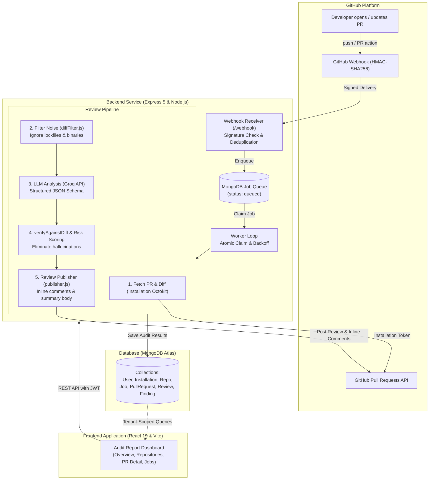

# AI PR Reviewer

**Autonomous pull request intelligence and line-accurate code review for modern engineering teams.**

You install the GitHub App on your repositories, and every incoming pull request is automatically analyzed the moment it is opened or updated. Diff noise and lockfiles are stripped, modified lines are analyzed against a security and correctness rubric, line-accurate review comments are posted directly to GitHub, and an executive risk assessment report is generated on your private dashboard.

- **🌐 [Live Application (Vercel)](https://pr-reviewer-kappa.vercel.app)**
- **⚡ [Production Backend API (Render)](https://pr-reviewer-backend-fstt.onrender.com)**
- **[Architecture](#architecture):** End-to-end system flowchart and component interaction breakdown.
- **[Review Pipeline](#pull-request-review-pipeline):** How diffs are fetched, filtered, verified against diff hunks, scored for risk, and published.
- **[Security & Multi-Tenancy](#security-and-multi-tenancy):** HMAC webhook verification, one-time OAuth exchange codes, and tenant-scoped isolation.

---

## Contents

1. [The problem](#the-problem)
2. [Who it's for](#who-its-for)
3. [Product philosophy](#product-philosophy)
4. [Workflows](#workflows)
5. [Pull request review pipeline](#pull-request-review-pipeline)
6. [Risk scoring and summary engine](#risk-scoring-and-summary-engine)
7. [Security and inline GitHub publishing](#security-and-inline-github-publishing)
8. [Multi-tenant architecture and GitHub App](#multi-tenant-architecture-and-github-app)
9. [Architecture](#architecture)
10. [Security](#security)
11. [Tech stack](#tech-stack)
12. [Project structure](#project-structure)
13. [Run locally](#run-locally)
14. [Environment variables](#environment-variables)
15. [Testing and test suite](#testing-and-test-suite)
16. [Deployment](#deployment)
17. [Limitations and trade-offs](#limitations-and-trade-offs)
18. [Future work](#future-work)

---

## The problem

Code reviews are one of the most critical phases of the software development lifecycle, yet they frequently create bottlenecks. Senior engineers spend hours reviewing boilerplate changes, while subtle security vulnerabilities, missing error handling, and concurrency issues slip through unnoticed.

Most generic AI code tools suffer from two major flaws:
1. **Hallucinated line numbers:** LLMs suggest comments on code lines that were never modified in the pull request, creating confusion or triggering GitHub API rejections.
2. **Style nits over real bugs:** Superficial suggestions about formatting and variable names rather than actionable insights on security flaws, unhandled exceptions, and architectural risk.

AI PR Reviewer addresses both: diffs are filtered deterministically, findings are verified against real diff hunks to eliminate hallucinations, and an executive audit report prioritizes critical vulnerabilities first.

---

## Who it's for

- **Individual developers** who want automated, continuous code feedback and risk ratings on their own private or open-source repositories before merging.
- **Engineering teams & tech leads** who want an automated first-pass reviewer that catches injection risks, secret leaks, and edge-case crashes before human review begins.
- **Open-source maintainers** handling community contributions who need immediate classification of pull request scope and risk level.

---

## Product philosophy

- **Verify before publishing (Zero hallucinations).** Every finding produced by the LLM is strictly validated against the diff's commentable line map (`verifyAgainstDiff`). If an issue points to an untouched line, it is dropped or moved to the review body rather than posting a misplaced inline comment.
- **Explain, don't just complain.** Every finding provides the observed defect, its severity, the file location, and a concrete, actionable fix with code suggestions.
- **Deterministic rules ground the AI.** Hardcoded security escalation rules inspect findings for credential leaks, injection vectors, and missing auth boundaries, ensuring critical flaws are never downplayed.
- **Multi-tenant by design.** User repositories, pull request jobs, and audit reports are strictly isolated by GitHub App installation credentials. Users only see and manage repositories they own.
- **Resilient background execution.** Reviews run asynchronously through an atomic database job queue with exponential backoff and stale job recovery. A transient LLM API spike never crashes the webhook receiver or drops a review.

---

## Workflows

```text
Developer opens PR ──▶ GitHub Webhook ──▶ HMAC SHA-256 verification ──▶ Idempotent Enqueue
                    ──▶ Background Worker (Atomic Lock) ──▶ Pipeline (Diff Fetch + Noise Filter)
                    ──▶ LLM Analysis + Schema Validation ──▶ Line-Hunk Verification
                    ──▶ Deterministic Risk Scoring ──▶ Publish Inline Comments & Summary to GitHub
                    ──▶ Store Audit Report in MongoDB ──▶ React 19 Executive Dashboard
```

1. **Authenticate & Connect.** Sign in using GitHub OAuth. The app discovers installations and automatically syncs accessible repositories.
2. **Webhook Ingestion.** GitHub sends signed `pull_request` payloads (`opened`, `synchronize`, `reopened`). The receiver validates HMAC-SHA256 signatures and enqueues review jobs idempotently using the delivery ID.
3. **Queue & Background Worker.** An in-process worker claims jobs using atomic locks (`findOneAndUpdate`), managing execution timeouts and retry backoff.
4. **Analysis Pipeline.** Fetches diffs via installation-scoped Octokit tokens, strips noise (lockfiles, vendor bundles, binaries), chunks large diffs, runs JSON-schema-validated LLM analysis, and applies deterministic security rules.
5. **Publish & Dashboard.** Posts line-level review comments and summary bodies directly to GitHub, while persisting the complete audit report for viewing in the React dashboard.

---

## Pull request review pipeline

### Pipeline stages

```text
Webhook Event
     │
     ▼
classifyEvent() ──────────▶ Discards drafts/closed PRs; extracts repo, commit SHA, installationId
     │
     ▼
jobQueue.enqueue() ───────▶ Idempotent unique index on deliveryId; avoids duplicate review jobs
     │
     ▼
claimNextJob() ───────────▶ Atomic status flip (queued → processing); increments attempt counter
     │
     ▼
getPullRequestFiles() ────▶ Paginated Octokit call fetching changed files and diff patches
     │
     ▼
prepareDiff() ────────────▶ Noise filter: ignores lockfiles, assets, and computes commentable lines
     │
     ▼
reviewChunks() ───────────▶ LLM prompt with strict JSON schema; automatic repair retry on malformed JSON
     │
     ▼
verifyAgainstDiff() ──────▶ Cross-references findings against actual modified lines; drops hallucinations
     │
     ▼
escalateFindings() ───────▶ Deterministic security checks (credentials, SQL/NoSQL injection, auth)
     │
     ▼
computeRisk() + summary ──▶ Weighted risk calculation (LOW, MEDIUM, HIGH) + executive overview
     │
     ▼
publishReview() ──────────▶ Submits inline review comments to GitHub API with 422 fallback protection
     │
     ▼
persist() ────────────────▶ Upserts PullRequest, Review, and Finding documents; marks Job 'done'
```

### A concrete finding example

```text
Severity:    CRITICAL
Category:    security
Location:    src/routes/users.js:42
Message:     Potential NoSQL injection vulnerability: req.params.id is passed directly into
             User.findOne() without sanitization or ObjectId validation.
Fix:         Validate that req.params.id matches /^[a-f0-9]{24}$/i before querying, or use
             mongoose.Types.ObjectId.isValid(req.params.id).
```

### Noise and diff filtering (`diffFilter.js`)

Pull requests often touch dependency lockfiles and generated assets that would waste model context and token budgets. The deterministic pre-filter automatically excludes:
- Lockfiles: `package-lock.json`, `pnpm-lock.yaml`, `yarn.lock`, `Cargo.lock`, `composer.lock`, `Gemfile.lock`.
- Minified assets: `*.min.js`, `*.min.css`, `*.map`.
- Binary files and SVGs.
- Vendor and generated directories: `dist/`, `build/`, `vendor/`.

---

## Risk scoring and summary engine

Risk is not a random guess—it is computed through deterministic checks combined with LLM assessment:

| Risk Rating | Criteria & Trigger Signals |
|---|---|
| **HIGH** | 1 or more `CRITICAL` findings, OR modifications touching sensitive boundaries (`auth`, `payments`, `credentials`, `migration`, `.env`). |
| **MEDIUM** | 3 or more `WARNING` findings, OR moderate changes touching architecture/configuration files. |
| **LOW** | Minor code adjustments, documentation updates, or code with only `SUGGESTION` findings. |

The summary engine (`summary.js`) generates:
1. **Executive Overview:** 2–3 plain-English sentences summarizing the purpose and impact of the PR.
2. **Identified Functional Changes:** Bulleted breakdown of major functionality added or modified.
3. **Risk Factor Explanation:** Clear justification explaining why the risk score was raised (e.g., *"Raised from medium to high: 3 critical findings."*).

---

## Security and inline GitHub publishing

### Publishing architecture (`publisher.js`)
- **Diff Line Mapping:** Findings on commentable lines are attached directly to the GitHub PR diff using `side: 'RIGHT'`.
- **422 Fallback Protection:** If GitHub returns `422 Unprocessable Entity` (e.g., if a line position shifted or is outside the diff hunk), the publisher catches the error and automatically reposts all findings formatted cleanly within the main review body. The review never fails or hangs.
- **Anti-Duplication Marker:** Every review embeds a hidden HTML comment marker `<!-- ai-pr-reviewer:sha=<commit> -->`. The publisher queries existing reviews on the PR first and skips posting if that commit was already reviewed.

---

## Multi-tenant architecture and GitHub App

Why a GitHub App instead of Personal Access Tokens (PATs)?
- **No shared credentials:** Users never paste personal access tokens into the application.
- **Short-lived tokens:** The backend uses the GitHub App's private key to mint short-lived installation access tokens per request (`octokit.auth`).
- **Granular permissions:** Read access to repository contents, read/write access strictly to pull requests.
- **Secure OAuth Handshake:**
  1. Frontend directs user to `/api/auth/github/login`.
  2. Backend sets `oauth_state` cookie (`SameSite=None; Secure` in production) and redirects to GitHub OAuth.
  3. Callback verifies state and exchanges code for user profile and installation access.
  4. Backend issues a one-time 60-second `AuthCode` (stored only as a SHA-256 hash in MongoDB).
  5. Frontend exchanges the one-time code for an 8-hour stateless JWT.
  6. All subsequent API queries are strictly scoped to `req.user.installationIds`.

---

## Architecture

### System Flowchart



### Component Breakdown

| Component | Technology | Responsibility |
|---|---|---|
| **Frontend** | React 19, Vite, React Router v7 | Dark-mode developer SPA: landing page, repository management modal, executive audit reports, queue job monitors, one-click report export. |
| **Backend API** | Node.js, Express 5 | REST endpoints for auth, repository controls, review data, webhook ingestion, and job management. |
| **Background Worker** | Custom async queue loop | Polling, atomic job locks, exponential backoff (30s base to 15m), and stale job crash recovery. |
| **Database** | MongoDB Atlas (Mongoose ODM) | Stores users, installations, repositories, jobs, pull requests, reviews, and findings. |
| **LLM Engine** | Groq API (`openai/gpt-oss-120b`) | Diff analysis, structured JSON extraction, and summary generation. |
| **GitHub Integration** | Octokit REST & GitHub App API | Webhook HMAC verification, installation token minting, and inline review publication. |

---

## Security

| Area | Implementation & Protections |
|---|---|
| **Webhook Verification** | HMAC-SHA256 signature verification on raw request bytes (`express.raw()`) using `GITHUB_WEBHOOK_SECRET`. |
| **Idempotency** | `X-GitHub-Delivery` ID tracked with a unique MongoDB index to reject duplicate or replayed deliveries. |
| **Sessions** | Stateless HS256 JWT (secret &ge; 32 chars in production), passed via `Authorization: Bearer <token>`. |
| **Auth Code Exchange** | One-time 60-second code with SHA-256 hash storage; raw code exists only in memory during exchange. |
| **Authorization** | Every API query resolves `req.user` from the JWT and restricts queries to authorized repository names. |
| **Diff Bounds** | Findings are verified against diff hunks; line numbers outside modified lines are discarded. |
| **Secrets Protection** | `.env`, `*.pem`, and `*.log` are git-ignored; sample templates provided via `.env.example`. |
| **CORS** | Configured with credential support, allowing authorized Vercel production domains and local development. |

---

## Tech stack

| Layer | Technologies |
|---|---|
| **Frontend** | React 19, Vite, React Router v7, Vanilla CSS Design System |
| **Backend** | Node.js 20+, Express 5, Octokit, Helmet, CORS, Rate Limit |
| **Database** | MongoDB Atlas, Mongoose ODM |
| **Authentication** | GitHub App OAuth 2.0, JWT (jsonwebtoken) |
| **AI / LLM** | Groq API (`openai/gpt-oss-120b`) / Anthropic / OpenAI |
| **Testing** | Vitest, Supertest (102 tests across 11 test suites) |
| **Deployment** | Vercel (Frontend SPA), Render (Backend Web Service) |

---

## Project structure

```text
.
├── backend/
│   ├── src/
│   │   ├── config/          Database connection, environment validation
│   │   ├── middleware/      Auth verification, error handlers, rate limiting
│   │   ├── models/          Mongoose schemas: User, Installation, Repo, Job, PullRequest, Review, Finding, AuthCode
│   │   ├── routes/          API routes: auth.js, api.js, webhook.js, health.js
│   │   ├── services/        Core logic: githubApp.js, github.js, diffFilter.js, llm.js, reviewEngine.js, risk.js, summary.js, publisher.js, pipeline.js
│   │   ├── worker/          Queue orchestration: queue.js, worker.js, handler.js
│   │   └── server.js        Express application bootstrap and graceful shutdown
│   ├── tests/               Vitest test suites (102 tests across 11 suites)
│   ├── scripts/             Diagnostic scripts: review-pr, inspect-pr, summarize-pr, send-webhook, test-auth
│   ├── .env.example         Backend configuration template
│   └── package.json
├── frontend/
│   ├── src/
│   │   ├── api/             API client with automatic token attachment
│   │   ├── auth/            AuthProvider, context, and useAuth hook
│   │   ├── components/      Badge, Loader, EmptyState, ErrorState, Layout
│   │   ├── pages/           Landing, Login, AuthCallback, Overview, Repositories, PRDetail, Jobs
│   │   ├── utils/           Date, string, and SHA formatters
│   │   ├── App.jsx          Route declarations
│   │   ├── App.css          Dark obsidian design system and audit report styling
│   │   └── main.jsx
│   ├── public/              Branded icons and favicon
│   ├── vercel.json          SPA client-side routing rewrite rules
│   ├── .env.example         Frontend configuration template
│   └── package.json
├── README.md
└── .gitignore
```

---

## Run locally

### Prerequisites

- Node.js 20+
- MongoDB Atlas account (free tier M0 cluster)
- GitHub App (registered on your GitHub account)
- Groq API key (free tier works)

### 1. Clone the repository

```bash
git clone https://github.com/akashpatel112005-hub/pr-reviewer.git
cd pr-reviewer
```

### 2. Install dependencies

```bash
# Install backend packages
cd backend
npm install

# Install frontend packages
cd ../frontend
npm install
```

### 3. Configure environment variables

**Backend Configuration (`backend/.env`):**
```env
PORT=5000
MONGODB_URI=mongodb+srv://<username>:<password>@cluster0.mongodb.net/pr-reviewer?retryWrites=true&w=majority
BACKEND_URL=http://localhost:5000
FRONTEND_URL=http://localhost:5173
JWT_SECRET=super_secret_jwt_key_at_least_32_characters_long

# GitHub App Configuration
GITHUB_APP_ID=5457654
GITHUB_APP_SLUG=ai-pr-reviewer-AkashPatel
GITHUB_APP_PRIVATE_KEY=<base64-encoded PEM private key>
GITHUB_CLIENT_ID=<your OAuth client id>
GITHUB_CLIENT_SECRET=<your OAuth client secret>
GITHUB_WEBHOOK_SECRET=<your webhook secret>

# LLM Provider
LLM_PROVIDER=groq
LLM_API_KEY=<your groq api key>
LLM_MODEL=openai/gpt-oss-120b
```

**Frontend Configuration (`frontend/.env`):**
```env
VITE_API_URL=http://localhost:5000
```

### 4. Start the application

```bash
# Terminal 1 - Start Backend API & Queue Worker
cd backend
npm run dev

# Terminal 2 - Start Frontend Vite Server
cd frontend
npm run dev
```

Open `http://localhost:5173` in your browser and click **"Sign in with GitHub"**.

---

## Environment variables

| Variable | Required | Purpose |
|---|---|---|
| `MONGODB_URI` | yes | MongoDB Atlas connection string |
| `JWT_SECRET` | yes | Secret key for signing and verifying user JWTs (&ge; 32 chars) |
| `BACKEND_URL` | yes | Base URL of the backend (used for OAuth redirect callbacks) |
| `FRONTEND_URL` | yes | Base URL of the frontend (used for CORS and post-login redirects) |
| `GITHUB_APP_ID` | yes | Numeric ID of your registered GitHub App |
| `GITHUB_APP_SLUG` | yes | URL slug of your GitHub App (for direct installation links) |
| `GITHUB_APP_PRIVATE_KEY` | yes | Base64-encoded RSA private key generated by your GitHub App |
| `GITHUB_CLIENT_ID` | yes | OAuth Client ID of your GitHub App |
| `GITHUB_CLIENT_SECRET` | yes | OAuth Client Secret of your GitHub App |
| `GITHUB_WEBHOOK_SECRET` | yes | Secret token used to verify HMAC-SHA256 signatures on webhooks |
| `LLM_PROVIDER` | yes | `groq`, `anthropic`, or `openai` |
| `LLM_API_KEY` | yes | API key for your chosen LLM provider |
| `LLM_MODEL` | yes | Model identifier (e.g. `openai/gpt-oss-120b`) |
| `VITE_API_URL` (Frontend) | yes | Public URL of the backend API |

---

## Testing and test suite

The backend includes a comprehensive automated test suite powered by **Vitest**:

```bash
cd backend
npm test
```

### Test coverage breakdown (102 tests across 11 suites)

- **`diffFilter.test.js` (11 tests):** Verifies lockfile filtering, minified code exclusion, commentable line calculation, and chunk size boundaries.
- **`webhookCore.test.js` (14 tests):** Validates HMAC signature calculation, event classification (`pull_request`, `installation`, `ping`), and delivery rejection.
- **`reviewEngine.test.js` (6 tests):** Tests LLM prompt construction, structured schema parsing, repair prompt retries, and duplicate finding merges.
- **`findingRules.test.js` (5 tests):** Tests deterministic security rule escalation for leaked credentials, SQL/NoSQL injections, and missing auth boundaries.
- **`risk.test.js` (10 tests):** Tests deterministic risk level scoring (`LOW`, `MEDIUM`, `HIGH`) and sensitive file touchpoint detection.
- **`summary.test.js` (7 tests):** Tests summary generation, bullet parsing, risk reasoning concatenation, and model failure recovery.
- **`publisher.test.js` (13 tests):** Tests inline comment creation, SHA marker deduplication, body truncation, and 422 fallback behavior.
- **`queue.test.js` (7 tests):** Tests atomic job claiming, exponential backoff computation, and stale job recovery.
- **`worker.test.js` (5 tests):** Tests job timeout handling, permanent vs transient error classification, and worker loop scheduling.
- **`pipeline.test.js` (10 tests):** Full integration test of diff fetching, review execution, summary creation, and database persistence.
- **`multiUser.test.js` (14 tests):** Tests URL parsing, installation sync events, JWT user signing, tenant-scoped data isolation, and PEM decoding.

---

## Deployment

The application is architected for zero-configuration cloud hosting:

```text
Browser ──HTTPS──▶ Vercel (React 19 SPA Build)
                     │
                     └──REST API / JWT──▶ Render (Node.js & Express 5 Web Service)
                                            ├── Worker Process (in-process job loop)
                                            ├── MongoDB Atlas (Mongoose ODM)
                                            ├── Groq API (High-speed LLM analysis)
                                            └── GitHub App API (Octokit Webhooks & Reviews)
```

### Production Endpoints

| Service | Platform | Production URL |
| :--- | :--- | :--- |
| **Frontend Application** | Vercel | [https://pr-reviewer-kappa.vercel.app](https://pr-reviewer-kappa.vercel.app) |
| **Backend API & Webhooks** | Render | [https://pr-reviewer-backend-fstt.onrender.com](https://pr-reviewer-backend-fstt.onrender.com) |
| **Source Code Repository** | GitHub | [https://github.com/akashpatel112005-hub/Pr-Reviewer](https://github.com/akashpatel112005-hub/Pr-Reviewer) |

1. **Backend on Render:**
   - Web Service connected to repository with Root Directory `backend`.
   - Build Command: `npm install`
   - Start Command: `node src/server.js`
   - Environment variables configured with MongoDB Atlas, Groq API, and GitHub App credentials.
2. **Frontend on Vercel:**
   - Root Directory `frontend`, Vite application preset.
   - Environment variable: `VITE_API_URL=https://pr-reviewer-backend-fstt.onrender.com`.
   - `vercel.json` rewrite rule automatically handles client-side SPA routing.
3. **GitHub App Settings:**
   - **Callback URL:** `https://pr-reviewer-backend-fstt.onrender.com/api/auth/github/callback`
   - **Webhook URL:** `https://pr-reviewer-backend-fstt.onrender.com/webhook`

---

## Limitations and trade-offs

- **In-process worker vs Redis/BullMQ:** An in-process worker eliminates external infrastructure costs and complexity for single-instance hosting, but requires polling MongoDB rather than a distributed Redis pub/sub queue.
- **LLM Rate Limits:** Free-tier LLM providers (e.g. Groq free tier) have request-per-minute limits. The worker's exponential backoff handles transient 429s automatically, but rapid high-volume PR pushes may experience slight queue delays.
- **Diff Chunking:** Very large pull requests (&gt;1,500 lines modified) are divided into chunks to respect model context windows, meaning cross-file architectural patterns across disparate files are evaluated per chunk.
- **Stateless JWTs:** User JWTs are stored in `localStorage` for cross-origin simplicity with Vercel and Render. They cannot be revoked server-side before their 8-hour expiration.

---

## Future work

- **Auto-Fix PR Generation:** A button on the dashboard allowing users to automatically generate a commit or branch applying the recommended code fix.
- **Slack & Discord Webhook Alerts:** Real-time notifications sent to team channels when a high-risk PR is detected.
- **Custom Rule Builder:** Allowing teams to define custom regex or lint rules specific to their internal code standards.
- **Distributed Redis Queue:** Upgrading to BullMQ when scaling horizontally across multiple worker instances.

---

## License

MIT &bull; Created for the End-Term Software Engineering Project.
